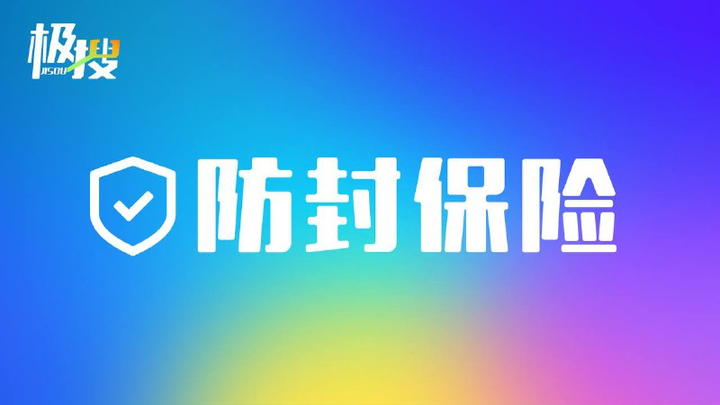
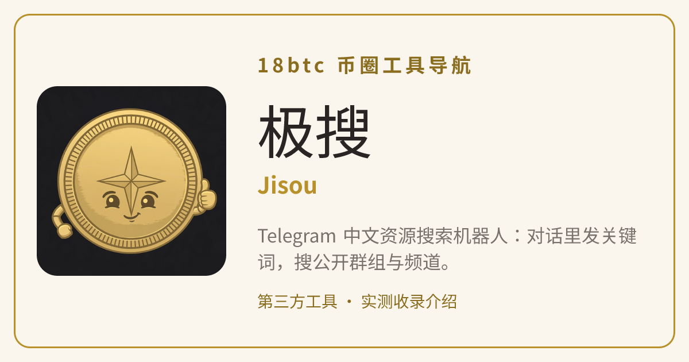

# 极搜 Jisou：Telegram 中文搜索机器人使用指南——搜群组、频道与资源

Telegram（电报 / 纸飞机）自带的搜索对中文内容并不友好：很多公开群组和频道用官方搜索根本翻不到。**极搜（Jisou）**就是为了解决这个问题而生的 **Telegram 搜索机器人**：不用装新 App、不用在网页上注册，只要在 Telegram 里打开机器人 @jisou，把想找的关键词发过去，它就会在自己收录的公开内容索引里帮你匹配群组、频道、机器人和各类资源。这篇指南把极搜的用法、常用命令、注意事项一次讲清；先打开 [极搜官方机器人](https://t.me/jisou?start=a_7847144671) 实际搜一次，比看十篇介绍都直观。

> **立即使用**：👉 [打开极搜机器人](https://t.me/jisou?start=a_7847144671) —— 在 Telegram 里发关键词，就能搜群组、频道、机器人与资源。

据其官网介绍，极搜每天有 500 多万人使用（该数字来自官方自述，无法独立核实，仅作参考）。它的官网是 jisou.cc，但官网本身不设搜索框——所有 TG 搜索都在 Telegram 机器人里完成，网站只承担产品介绍和使用指南。

## 极搜能搜什么：Telegram 群组、频道、机器人与资源索引

极搜的索引主要覆盖可公开访问的 Telegram 内容，发送一个关键词，通常能得到几类结果：

- **群组**：按主题、地区、行业收录的公开讨论群，适合找同行交流、兴趣社群、本地生活群；
- **频道**：资讯、影视、音乐、资源发布类公开频道，适合订阅内容来源；
- **机器人**：其他 Telegram Bot 的入口，可以顺藤摸瓜找到更多工具；
- **资源内容索引**：视频、音乐、新闻、帖子等公开内容的索引结果。

在关键词理解上，极搜针对中文做了优化：按其官网说明，它能识别常用简称、口语词和同义表达，支持「地区名 + 主题词」的组合匹配（例如城市名加行业词），因为写法不同而搜不到的情况会少一些。想先看它收录了哪些分类，进机器人里用 /daoh 逛分类导航即可。

## 怎么用极搜：三步完成一次 TG 搜索

整个流程不需要任何额外注册，有 Telegram 账号就能用：

**第一步：打开极搜机器人。** 在 Telegram 里搜索 @jisou，或直接点 [极搜官方机器人](https://t.me/jisou?start=a_7847144671) 进入对话。认准下面的官方头像，避免点进仿冒机器人：

**第二步：发送清晰关键词。** 直接把关键词发到对话里，或用 `/search 关键词` 的格式。新手建议先用一个明确的名称或主题词（比如频道名、作品名、城市名加行业词），词越具体，结果越准。

**第三步：查看并筛选结果。** 机器人会按相关性返回公开频道、群组或机器人列表，点开简介判断是否对口再加入。如果没有命中，先缩短关键词，只保留一个地区词和一个主题词，再换同义词、城市简称或作品原名重试——这是极搜官网 FAQ 给出的官方建议。

## 极搜常用命令：让电报搜索更快的几个指令

除了直接发关键词，极搜还提供几个命令（据第三方机器人目录 findmini 记载，官网亦提到 /search 用法）：

| 命令 | 作用 |
| --- | --- |
| `/search 关键词` | 按关键词发起一次 Telegram 搜索 |
| `/reso` | 查看近期热搜，了解大家都在搜什么 |
| `/daoh` | 打开分类导航，按类别逛群组和频道 |
| `/help` | 查看使用教程和帮助说明 |

找热门资源时可以先用 /reso 看榜单找灵感；目标明确时直接发关键词最快；完全没头绪时用 /daoh 按分类慢慢逛，比漫无目的翻 Telegram 高效得多。

## 极搜的三个 Telegram 搜索机器人与公告频道

自 2024 年起，极搜启用了三个功能相同、用户相通的机器人互为容错：

- 主机器人：**@jisou**
- 备用机器人：**@jisou2**、**@jisou3**
- 官方公告频道：@JISOU1（功能更新与运营公告）
- 交流群：@jisou0

这样设计的原因很现实：某一个机器人被限制或连不上时，换另一个就能继续搜索，不会直接「断粮」。主号打不开时，先去公告频道看一眼有没有说明，再换备用机器人试：[打开极搜机器人](https://t.me/jisou?start=a_7847144671)。极搜官方也长期把「防封」当作运营重点，下图是其公告频道发布过的防封主题海报：

## 使用极搜的注意事项：纸飞机搜索结果要自行甄别

工具再方便，边界也要清楚。使用极搜做 Telegram 频道搜索和搜群时，注意以下几点：

- **结果是公开内容的机器索引，质量参差**：相关性排序不等于信用认证，列表里广告、引流和低质量群组不少，加入前先看简介和近期内容，自行甄别；
- **机器人内有广告位与推广内容**：看到「热门推荐」之类的条目，保持平常心，把它当广告看；
- **部分敏感关键词会被屏蔽**：搜不到不代表不存在这类内容，可能只是被过滤；
- **需要 Telegram 账号**：没有账号、用不了 Telegram 的网络环境里，这个工具就用不上；
- **下载与交易安全自负**：通过搜索结果下载文件、参加交易或投资类群组前，务必自行核实来源。极搜运营方自己也发布过整肃欺诈信息的公告，反诈这根弦不能松。

## 常见问题 FAQ：Telegram 中文搜索与极搜使用答疑

**问：极搜是 Telegram 官方的搜索功能吗？**
答：不是。极搜是第三方开发的 Telegram 搜索机器人，只是运行在 Telegram 平台内，借助机器人对话提供 TG 搜索服务，与 Telegram 官方搜索是两回事。

**问：为什么不在 Telegram 里直接搜群，非要用极搜？**
答：Telegram 官方搜索主要匹配名称，对中文群组、频道的内容索引覆盖有限，很多公开资源搜不到。极搜的索引包含群组简介、频道内容等更多维度，中文关键词的命中率更高，这也是多数人用它做 Telegram 中文搜索的原因。

**问：极搜官网为什么没有搜索框？**
答：按其官网说明，为了让搜索入口、结果展示和后续操作保持一致，官网不提供站内搜索，只做产品介绍和指南，实际搜索统一在机器人会话内完成。

**问：@jisou 打不开或没反应怎么办？**
答：先到公告频道 @JISOU1 确认是否有维护或限制公告，然后改用功能相同的备用机器人 @jisou2 或 @jisou3；三个机器人的搜索结果是相通的，不用担心数据不一致。

**问：用极搜搜不到想要的频道怎么办？**
答：按官网 FAQ 的建议：缩短关键词，只留一个地区词加一个主题词；再尝试同义词、城市简称、人物译名或作品原名。若公开资源尚未被收录，也可能暂时没有结果，过段时间再试。

## 相关链接

- [极搜官方机器人 @jisou](https://t.me/jisou?start=a_7847144671) —— Telegram 内打开即用（主入口）
- [极搜工具详情页](https://18btc.cc/tool/jisou) —— 18btc 币圈工具导航的收录介绍

